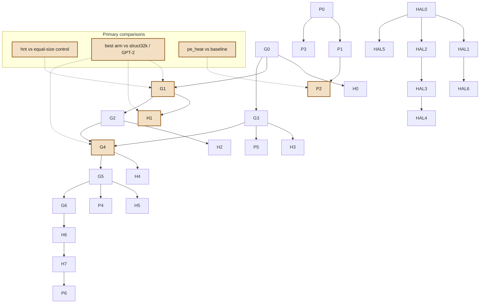

# Gates

Gate contract for HaDukeN //\\\\// HGNLLM Experiments. The package name is `sheaf-verify`.

A gate passes only when every criterion it writes has passed, and every gate it depends on has a passing ledger record bound to the same manifest and payload hashes. `run` still writes the failures.

The ids follow the architecture spec. H0–H7 are the stages. G0–G6 are the go/no-go lines of H0–H6. H7 has no numeric gate. P0–P6 are the paper-plan phases. `sheaf-verify run --profile training` (the default) evaluates only that graph. `sheaf-verify run --profile hal` evaluates only HAL0–HAL6, the fail-closed hardware / microbench family. The profile is selected explicitly and is recorded on every ledger record and on the result manifest. A training study cannot skip G/H/P by choosing a HAL claim; the requested profile is what is walked. Thresholds below are per-gate parameters taken from those documents. A study cannot loosen them by writing a smaller number into its metrics. There is no single seed minimum: pilots use 3, the headline uses 5. The old global `MIN_SEEDS = 5` would have failed a valid 3-seed pilot.

## Control graph

Solid arrows are dependency edges. Dotted arrows are not edges. They mark the primary comparisons: hnt versus the equal-size control, the best arm versus struct32k and GPT-2 at matched bytes and FLOPs, and pe_heat versus the baseline. G1, H1, G4, and P2 are the gates those comparisons land on. The same diagram is on the briefing site at `docs/graph.html`. The diagram is generated from `gates.GATES` by `python -m sheaf_verify.control_graph --write`; CI runs `--check` and a test fails when `docs/control-graph.mmd`, this block, or `docs/graph.html` drift from the code.

The gate trace used by the coverage check is tri-state. `pass` and `fail` mean the gate's own criteria ran. `blocked` means an upstream gate had no passing record bound to the same hashes, so the gate's own criteria never ran. The ledger keeps the binary `status`; `blocked` exists only in the trace and the coverage matrix.



```
PILOT_SEEDS = 3
HEADLINE_SEEDS = 5
G0_MIN_UNIT_REDUCTION = 0.15
G0_MAX_BYTE_FALLBACK_PERCENT = 1
G0_VOCAB_CAP = 64000
G0_RECORDED_VOCAB = 65536
G0_MAX_BUILD_CPU_HOURS = 2
G0_MAX_BUILD_RAM_GB = 16
G1_SD_MARGIN = 1
G3_MAX_REL_ERR = 0.001
G3_MAX_SHEAFHEAT_FRACTION = 0.15
G4_MIN_BASELINE_SD = 2
P4_SEEDS_15M = 3
P4_SEEDS_30M = 3
P4_SEEDS_60M = 2
P4_SEEDS_120M = 1
MAX_FLOP_RELATIVE_TOLERANCE = 0.05
ALPHA = 0.05
MIN_BOOTSTRAP_DRAWS = 1000
MAX_BOOTSTRAP_DRAWS = 100000
HAL_MAX_ABS = 1e-4
MIN_TIMING_REPEATS = 3
```

`MAX_FLOP_RELATIVE_TOLERANCE` is the harness reading of the word "matched" where the spec does not give a numeric band. `ALPHA` is the one-sided threshold for G2 and G4. The methodology block inside G4 still recomputes a two-tailed Welch test, a bootstrap interval, and Hedges' g; that two-tailed bar is stricter than the one-sided spec test and is not a second alpha.

The order below is the topological order of the graph.

## P0 Fairness

Binds the claim, metrics, code, environment, config, seeds, kernel, the three checkpoints, and the three logs. No dependencies.

The claim is frozen before the metrics exist and does not quote the metrics hash. A structured claim needs a hypothesis id, a description of at least 20 characters, metric `bpb`, direction `less`, alpha equal to `ALPHA`, and a primary contrast that is one of the control arms. The payload must not contain a 64-character hex digest.

The fairness record logs bytes/s, FLOPs, and MFU. `schedule_complete` is true. `baseline_wall_interpolated` is false: a mid-schedule wall comparison is not a result.

The code snapshot matches the listing, and the recomputed git tree SHA-1 matches the manifest. Environment fields are non-blank and are not `unknown`, `none`, or `n/a`. Config is a non-empty JSON object. Each checkpoint is external and cites the code, config, seeds, and kernel manifests. Each log is non-empty and cites its checkpoint.

## G0 Unit reduction on WT103 valid

Binds `metrics`. No dependencies.

The `sheaf-verify.g0.v1` record is either `synthetic` or `recorded_metadata`, and `not_data` is true. A recorded record's note says it is not corpus bytes. Counts are for the valid split against GPT-2 BPE.

- Fewer units: `1 - valid_units / gpt2_bpe_valid_units >= G0_MIN_UNIT_REDUCTION` (15%).
- Byte fallback: `byte_fallback_percent <= G0_MAX_BYTE_FALLBACK_PERCENT` (1%).
- Vocabulary: `vocab_size <= G0_VOCAB_CAP` (64,000). The written gate says `V ≤ 64k`. The feasibility build recorded `V = 65,536` (`G0_RECORDED_VOCAB`), which is 2^16 and is also called 64k in tokenizer sizes. Those two readings disagree. The harness uses the literal cap 64,000 and flags 65,536. It does not treat 65,536 as inside the cap.
- Build: `build_cpu_hours <= G0_MAX_BUILD_CPU_HOURS` (2) and `peak_ram_gb <= G0_MAX_BUILD_RAM_GB` (16).

`fixtures/g0-recorded/` is that feasibility record: 27.35% fewer units on valid (181,544 vs 249,887), 0.048% fallback, 0.093 CPU-h, 4.83 GB peak, `V = 65,536`. It is recorded metadata, not data. The vocab criterion fails. The other four pass.

## H0 Corpus stats

Binds `metrics`, both hypergraphs, and the three corpora. Depends on G0.

The stage card says work `Corpus stats` and gate `G0`. Train, validation, and test payload hashes differ. Document ids are unique inside a split and pairwise disjoint across splits. Each split is non-empty. Metadata orders are integers with train < valid < test. Both hypergraphs are built from train only. An attached 2-complex must satisfy the boundary identity.

## G1 Units-only pilot

Binds `metrics`, the three corpora, and `vocabulary`. Depends on G0.

Arms `hnt64k`, `struct32k`, and `sw64k` are required. This is the units-only pilot: hnt64k against struct32k, with sw64k as the equal-size superword-BPE control.

- Each arm has at least `PILOT_SEEDS` (3) per-seed BPB values. The gate counts those lists. It does not read a minimum out of the metrics file.
- hnt64k mean test BPB_corpus `<=` struct32k mean `+ G1_SD_MARGIN` (1) sample standard deviation of struct32k.
- hnt64k `train_flops_per_byte` is strictly lower than struct32k and strictly lower than sw64k.
- sw64k `vocab_size` equals hnt64k.
- hnt64k `graph_build_flops` is positive. The training-FLOP comparison above does not fold that number in; the all-in comparison is G4.
- Train bytes equal the train corpus. The BPB denominator is `raw_corpus_bytes`. Scored bytes equal the test corpus.

The same gate also checks the methodology trio (`hypergraph`, `superword_bpe`, `randomized_hypergraph`): totals equal train plus graph build, graph arms charge a positive graph build, superword-BPE records graph build as 0, train bytes match, the relative span of totals is within `MAX_FLOP_RELATIVE_TOLERANCE`, BPB uses raw test bytes, and the vocabulary is one shared size with a superword-BPE arm present.

## H1 Units-only pilot stage

Binds `metrics`. Depends on G1.

The stage card says work `Units-only pilot` and gate `G1`. GPT-2 BPE is present beside hnt64k and is trained on the same number of bytes. The spec's H1 comparison is A1 against GPT-2 BPE, struct32k, and equal-size superword BPE. G1's numeric line does not require beating GPT-2 BPE.

## G2 Spectral and compositional embeddings

Binds `metrics`. Depends on G1.

Two comparisons, each with at least `PILOT_SEEDS` seeds:

- `a2_spectral` against `shuffled_degree`
- `a3_compositional` against `random_dag`

Each must have a lower mean BPB than its control. The one-sided Welch p-values must survive Holm at `ALPHA`.

## H2 Spectral and compositional stage

Binds `metrics`. Depends on G2.

The stage card says work `Spectral and compositional embeddings` and gate `G2`. The numeric gate is G2.

## G3 Kernel microbench

Binds `metrics` and `kernel`. Depends on G0.

`dtype` is `bf16`. Relative error against the recorded reference is at most `G3_MAX_REL_ERR` (0.001). SheafHeat's share of the step is at most `G3_MAX_SHEAFHEAT_FRACTION` (0.15). These are checks of the submitted microbench record. The harness does not launch the kernel.

Kernel metadata needs `backend` (`cpu`, `cuda`, `opencl`, or `c`) and `entry`. A device backend must set `host_reference_sha256` to a different payload hash that belongs to one of the kernel manifest's inputs.

## H3 Kernel stage

Binds `metrics`. Depends on G3.

The stage card says work `Kernels K2/K4 and CUDA graph` and gate `G3`.

## P1 Finish ablations

Binds `metrics`. Depends on P0.

The record lists `s4d`, `hybrid`, `sheaf_reg`, `random_rewire`, `spectral_init`, `shape_matched`, and `enhanced_wallmatch`. Those names are the paper plan's remaining ablation list. The harness checks that the list was submitted. It does not rerun the arms.

## P2 Strong baseline

Binds `metrics`. Depends on P1.

A tuned modern baseline is named. The PE controls are sinusoidal, RoPE, ALiBi, NoPE, heat, and heat+RoPE. No recorded campaign run has tested a heat encoding: every G1-family run so far applied RoPE. The G4 headline seed list has at least `HEADLINE_SEEDS` (5). A declared `headline_seeds` smaller than 5 fails even if some other field looks complete.

## P3 Data

Binds `metrics`. Depends on P0.

A full WikiText-103 epoch is recorded. FineWeb-Edu validation BPB is a positive number. `record_class` is `synthetic` or `recorded_metadata`, and `not_data` is true. The synthetic fixture's FineWeb number is not a measured FineWeb run.

## P5 Speed

Binds `metrics`. Depends on G3.

`cuda_graph_all_arms` is true, and `time_to_target_bpb_s` is positive. The paper plan applies the whole-step CUDA graph to every arm, including the baseline.

## G4 Full HNT at matched all-in FLOPs

Binds `metrics`, `seeds`, `claim`, and both hypergraphs. Depends on G2 and G3.

Headline and tuned-modern baseline each have at least `HEADLINE_SEEDS` (5) BPB values. The BPB gain (baseline mean minus headline mean) is greater than `G4_MIN_BASELINE_SD` (2) baseline sample standard deviations. Headline all-in FLOPs equal train FLOPs plus a positive graph build, and the two all-in totals match within `MAX_FLOP_RELATIVE_TOLERANCE`.

Components `spectral`, `compositional`, `attention_bias`, and `sheaf_heat` each beat a `random_hypergraph` control on at least `PILOT_SEEDS` (3) seeds. One-sided Welch p-values survive Holm at `ALPHA`.

The methodology seed lists on the seeds artifact also use `HEADLINE_SEEDS`. A 3-seed methodology list fails here and does not fail G1. Reported Welch, bootstrap, and effect-size fields, when present, must match the recomputation. A superiority claim fails when the superword-BPE contrast and the randomized-hypergraph contrast disagree. A study that claims nothing still records the disagreement and can pass G4.

## H4 Ablations and headline

Binds `metrics`, `hypergraph`, and `trace.causality`. Depends on G4.

The stage card says work `A4-A7 and leave-one-out` and gate `G4`. The causality trace must cite the study hypergraph. Perturbing a future position leaves past outputs unchanged and changes the probed future positions. Consulted edges end at or before the predicted position. An attached sheaf block must agree on converging restriction paths.

## G5 Scaling slope

Binds `metrics`. Depends on G4.

Sizes are 15M, 30M, 60M, and 120M parameters. Gain is positive at every size. The ordinary-least-squares slope of gain against log(parameters) has a 95% Student-t interval that excludes 0, and the slope is not negative. The parenthetical in the spec is the interval test. The sentence "does not shrink to zero" is the non-negative slope plus the positive gains. A significant negative slope fails even though its interval excludes 0.

## H5 Scaling stage

Binds `metrics`. Depends on G5.

The stage card says work `Scaling 15-120M and FineWeb-Edu` and gate `G5`. The FineWeb-Edu field from P3 must still be present.

## P4 Scaling ladder

Binds `metrics`. Depends on G5.

Seed counts on the same four sizes meet the paper-plan schedule: `P4_SEEDS_15M = 3`, `P4_SEEDS_30M = 3`, `P4_SEEDS_60M = 2`, `P4_SEEDS_120M = 1`. These are not the headline minimum. A 120M arm with one seed can pass P4 and still fail G4 if that arm is presented as the headline.

## G6 Motif head and corpus memory

Binds `metrics`. Depends on G5.

The arm is `motif_head` or `corpus_memory`. Its BPB is lower than A7, and all-in FLOPs match A7 within `MAX_FLOP_RELATIVE_TOLERANCE`.

## H6 Motif-head stage

Binds `metrics`. Depends on G6.

The stage card says work `Hyperedge output head and corpus-memory arm` and gate `G6`.

## H7 lm-eval and write-up

Binds `metrics` and `figure`. Depends on H6.

The stage card says work `lm-eval and write-up` and gate `none`. lm-eval tasks are listed and `headline` is false: downstream evals at this scale are reported, not headlined. The figure metadata cites the metrics payload, the figure provenance cites the metrics manifest, and the payload starts with an SVG or XML marker.

## P6 Evals and replication

Binds `metrics`. Depends on H7.

`replication_recorded` is true and `replication_note` has at least 20 characters. The note is a submitted record. The harness does not contact another machine.

## HAL profile

The HAL graph is a separate study kind for hardware and microbench runs. It does not replace G0–P6. Gates recompute from registered payloads or a live probe. A self-reported speedup, cosine, or temperature in a campaign JSON is not evidence.

### HAL0 HAL profile and claim

Binds `claim`. No dependencies.

The claim format is `sheaf-verify.hal-claim.v1`. `study_profile` is `hal`. The description is at least 20 characters. Performance claims use metric `speedup` in the `greater` direction, subject `c11_tiled_cce`, and a stated baseline that is `serial_python_loop` or `packed_numpy`. `baselines_reported` must include both. `min_speedup` is a positive number. Parity `max_abs` may tighten, but must not exceed `HAL_MAX_ABS = 1e-4`. The claim must not contain a 64-character hex digest. If metrics are also registered, the claim timestamp is earlier than the metrics timestamp.

### HAL1 Environment live-probed

Binds `environment`. Depends on HAL0.

The environment format is `sheaf-verify.environment.v1` with non-blank python, cuda, driver, gpu, and platform. The harness re-probes the live machine and compares each field to the registered payload. A mismatch, or a probe that cannot observe a claimed field, fails.

### HAL2 Code tree hashed

Binds `code`. Depends on HAL0.

The registered code listing is recomputed against the snapshot bytes and the git tree hash, using the same `code_tree_criteria` as a training study.

### HAL3 Kernel host-reference binding

Binds `kernel`. Depends on HAL2.

A `c`, `cuda`, or `opencl` kernel must name a distinct `host_reference_sha256` that is the payload of an input manifest. If `kernel.cuda` is also registered, the same rule applies to it.

### HAL4 Numeric parity vs float64 reference

Binds `log.parity` and `kernel`. Depends on HAL3.

The parity log format is `sheaf-verify.hal-parity.v1`. Each `cce_mup_fwd` case supplies inputs `H`, `E`, `y`, and `mup_base_d`. The harness recomputes Cut-Cross-Entropy in stdlib float64 and compares the registered kernel `loss` to that reference. The cap is the claim's `max_abs`, at most `HAL_MAX_ABS`. Self-reported error fields are ignored.

### HAL5 Performance from raw timings

Binds `claim` and `log.timings`. Depends on HAL0.

The timings log format is `sheaf-verify.hal-timings.v1`. Each case must include at least `MIN_TIMING_REPEATS = 3` raw finite repeats for the subject and for both `serial_python_loop` and `packed_numpy`. The harness recomputes mean, sample standard deviation, and speedup (`baseline_mean / subject_mean`). The pass/fail threshold uses only the claim's own stated baseline and `min_speedup`. The other baseline is still reported. A self-reported speedup field, if present, must match the recomputation.

### HAL6 Thermal and power guards

Binds `claim`, `log.guards`, and `environment`. Depends on HAL1.

The guards log format is `sheaf-verify.hal-guards.v1`. At least two numeric temperature samples are required, `stop_celsius` must not exceed `claim.guards.thermal_stop_celsius` when declared, and the peak must stay strictly below `stop_celsius`. If power is observed, `draw_watts` is required. If power is unobserved, the log must record the probe command and the reason it failed. A study may not silently omit the probe.

